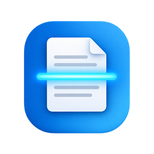

# ScanManager

A Windows desktop app for scanning documents: scan from the flatbed or the document feeder (single- or double-sided), choose the scan area on a preview, tidy pages up, and save them as PDF, TIFF, PNG or JPEG.

## Features

**Scanning**
- Works with any scanner Windows can see through WIA (USB scanners and network multifunction printers). Network scanners that speak eSCL (AirScan/Mopria) are driven directly over the network, which is more reliable than going through Windows' generic driver — for example, it makes duplex work on printers where the WIA route rejects it.
- Flatbed, document feeder, and duplex (both sides) when the scanner has them. Feeder jobs keep scanning until the feeder is empty.
- Color, grayscale and black & white; resolution choices come from the device.
- **Preview** scans the whole glass at low resolution; drag the frame (or its handles) to choose the area to scan, or pick a paper size preset (Letter, Legal, A4, A5, photo sizes, …). Arrow keys nudge the frame.
- Brightness / contrast, and a threshold for black & white. When the scanner has no hardware control for these (common on network scanners), they are applied in software after scanning.
- Skip blank pages (for feeder jobs) — handy for the empty backs of single-sided sheets in a duplex scan.
- Cancel a feeder job between pages.
- Choose a default source in **Settings** (for example the document feeder); it is selected at startup and whenever you switch scanners. If a scanner lacks it, the closest source it has is used.

**Pages**
- Rotate (left, right, 180°), crop, delete, and reorder (buttons or drag & drop in the page list).
- Undo for every page operation, including deletes and "clear all".
- Add existing images as pages (button, Ctrl+O, or drop files on the window). Multi-page TIFFs are split into pages.

**Output**
- PDF (black & white pages stored lossless 1-bit, others as JPEG), multi-page TIFF (CCITT G4 for black & white, LZW otherwise), or one PNG/JPEG per page.
- Print at true size, shrinking only pages larger than the paper.

Keyboard: `F5` scan · `Shift+F5` preview · `Ctrl+S` save · `Ctrl+P` print · `Ctrl+O` add images · `Ctrl+Z` undo · `Ctrl+R` / `Ctrl+Shift+R` rotate · `Del` delete page · `Enter` / `Esc` apply / cancel crop.

## Requirements

- Windows 10 or 11
- [.NET 10 SDK](https://dotnet.microsoft.com/download) to build

## Build and run

```bash
dotnet build
```

```bash
dotnet run --project src/ScanManager.App
```

```bash
dotnet test
```

Debug builds also list a **Test scanner (simulated)** with a flatbed, feeder and duplex, so every feature can be tried without hardware or paper. Release builds show it when started with `--simulator`.

## Project layout

| Project | Purpose |
| --- | --- |
| `src/ScanManager.Core` | Platform-neutral pieces: scanning abstractions (`IScannerBackend`, `ScanSettings`, capabilities), scan-area geometry and paper sizes, pixel operations (brightness/contrast, thresholding, blank-page detection), a dependency-free PDF writer, settings storage. |
| `src/ScanManager.Escl` | `EsclScannerBackend`: network scanners over eSCL (HTTP + XML): capabilities, status, scan jobs, page-by-page download. |
| `src/ScanManager.Wia` | `WiaScannerBackend`: scanner access through the WIA 2.0 Automation Library (late-bound COM, no interop assembly), with all COM calls on a dedicated STA thread so the UI never freezes. Also `WindowsEsclDeviceSource`, which finds the eSCL scanners Windows has installed. |
| `src/ScanManager.App` | The WPF app (MVVM with CommunityToolkit.Mvvm, Windows 11 Fluent theme). `RegionSelector` is the frame control used both for the scan area and for cropping. Page images are kept as PNG files in a temp session folder rather than in memory, which keeps long feeder jobs light and makes undo cheap. |
| `src/ScanManager.Cli` | `scancli`, a small command-line tool over the same backend — useful for diagnosing driver issues. |
| `tests/ScanManager.Core.Tests` | xUnit tests for the core library. |
| `tests/ScanManager.App.Tests` | xUnit tests for the app's imaging code (including cross-thread use of page images). |

### scancli

```bash
dotnet run --project src/ScanManager.Cli -- list
```

```bash
dotnet run --project src/ScanManager.Cli -- caps 1
```

```bash
dotnet run --project src/ScanManager.Cli -- scan 1 --source feeder --dpi 300 --color gray --out page.bmp
```

`--area x,y,w,h` (inches) limits the scan area; `--source` is `flatbed`, `feeder` or `duplex`; `--color` is `color`, `gray` or `bw`.

## Adding another scanner technology

Scanner access goes through `IScannerBackend` (`GetDevicesAsync`, `GetCapabilitiesAsync`, `ScanAsync`). A new backend (TWAIN, for example) is added by implementing it and registering it in `App.xaml.cs`; the UI picks up its devices automatically. Backends are asked in order and the first to report a device wins, so a scanner reachable over eSCL is not listed a second time through WIA.

## Settings and temporary files

- Preferences: `%AppData%\ScanManager\settings.json`
- Page images while the app runs: `%Temp%\ScanManager\session-*` (deleted on exit; leftovers from crashes are removed after two days)
